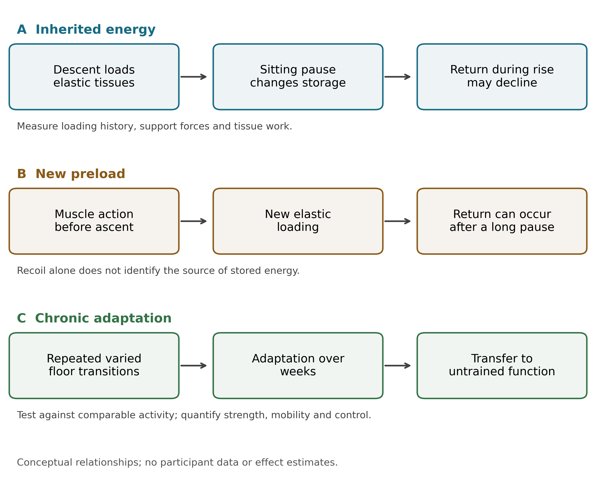
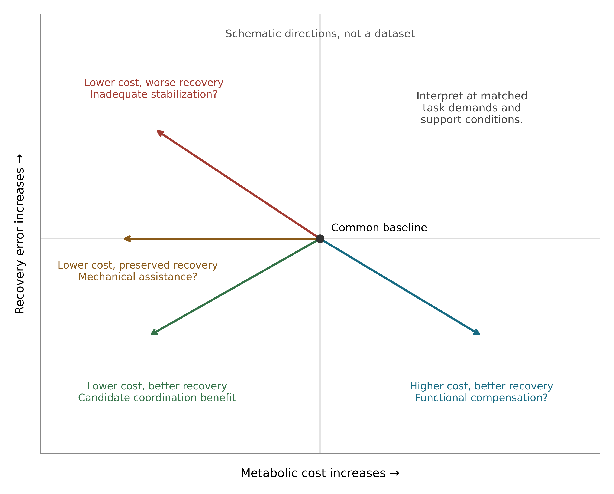

## Abstract

Floor-to-stand ability predicts adverse outcomes, and floor-rise practice can improve task performance, but neither finding identifies the mechanism of any benefit. We propose the sitting pause between descent and ascent as an experimental probe that separates three processes in functional aging: elastic energy stored during descent, fresh muscle-generated preload before ascent, and chronic adaptation to changing support geometry. A falsifiable mechanical prediction is stated in advance. If the returnable viscoelastic branch has an effective relaxation time of at most 10 s, consistent with human tendon hysteresis and muscle stress-relaxation measurements, then descent-attributable return should fall to no more than 13.5% of the prompt-reversal value after a 10 s pause and 1.8% after 20 s; measured retention above 25% after a 15 s pause would reject that band. An illustrative viscoelastic balance, extended with a tension-only variant that removes unphysical compression artefacts, makes the arithmetic explicit. We propose sequential identification experiments with motion-gated pauses and an assessor-blinded 12–16 week trial of floor practice against dose-matched chair/step practice, with a pre-committed usefulness criterion: a between-group difference in usual gait speed of at least 0.10 m/s. Mutual information enters only as a secondary held-out predictive test, and no thermodynamic bound is applied to the task budget. Prespecified findings distinguish passive recycling, muscle–tendon coordination, task learning, and general functional transfer; disability-free survival and mortality require independent investigation.

**Keywords:** functional aging; floor-to-stand transitions; elastic recoil; postural control; sensorimotor adaptation; healthspan

## 1. Introduction

The ability to move between the floor and standing integrates mobility, strength, balance, and the selection of a feasible movement strategy. Baseline sitting–rising test performance predicts mortality in clinical cohorts, but predictive ability does not demonstrate that repeatedly performing the task improves survival [@brito2014; @araujo2025]. A useful longevity hypothesis must identify a modifiable process and distinguish it from the health that already permits floor rising. Exercise has a causal benchmark in functional aging: structured physical activity reduced major mobility disability in the LIFE randomized trial [@pahor2014]. A floor-specific proposal therefore requires evidence of incremental benefit or a measurable practical advantage over suitable activity.

Floor practice is also an established research topic. Early strategy training improved floor-rise ability, and recent trials have examined functional and psychological outcomes [@hofmeyer2002; @seeley2026]. The 2026 Floor-Hugging exploratory study combined floor exposure and post-fall recovery practice, with favorable functional changes in a small uncontrolled sample [@ghai2026]. Consequently, neither recommending floor practice nor linking it to balance constitutes the contribution of the present paper.

The unresolved question addressed here concerns the relationship between an acute energy-recycling mechanism and a chronic training mechanism. Lowering the body may load elastic tissues. Returning promptly to standing could recover some of that energy, whereas a sustained sitting interval changes the loading history and allows some stored energy to dissipate or become inaccessible. However, muscles can load elastic tissues afresh before standing, and repeated transfers may train coordination independently of passive return. The same observable improvement can therefore have different sources and implications.

We propose using the sitting pause as an experimental discriminator, together with independent control of rising speed and measured support. Our central hypothesis is that repeated floor transitions can preserve adaptive control across changing body-support configurations, with transfer beyond the practiced task, even when energy inherited from the preceding descent is reduced. This is a hypothesis of functional aging. Its relevance to longevity proceeds through sustained mobility and independence and requires separate outcome evidence.

## 2. What prior work establishes, and what remains open

### 2.1. Resting posture, transitions, and prognosis are different exposures

The inactivity mismatch hypothesis arose from observations of nonambulatory postures among Hadza adults and measurements showing elevated muscle activity in some squatting postures compared with chair sitting [@raichlen2020]. It concerns muscular engagement during rest. Static floor sitting, squatting, kneeling, the number of transitions, and their timing should therefore be recorded separately. Their effects cannot be inferred from a common label such as floor use.

Similarly, a sitting–rising test score describes capacity under an assessment protocol, not habitual exposure. Illness, weakness, pain, or limited mobility can both reduce floor use and increase subsequent disability or mortality. A baseline association can arise without an independent training effect. Claims that any population performs a particular number of rises each day require direct exposure measurement, and demographic differences across birth cohorts discourage treating long-lived populations as natural exposure experiments [@poulain2024].

### 2.2. Elastic return and movement economy are already connected

A passive knee-assist device stored energy during sitting and released it during standing, reducing metabolic power in repeated chair transfers in healthy adults [@lee2020]. This demonstrates an engineering route to economy, not the magnitude of native floor-rise recoil. Ultrasound during squat jumps without a preceding countermovement also demonstrated elastic loading through muscle action [@kurokawa2001]. Thus, observing tendon recoil does not establish recovery of energy from the preceding descent.

Tendon measurements depend on tissue, operating range, and protocol. Human experiments show that measured hysteresis can depend on force-relaxation duration, and loading-rate experiments do not support assigning a universal loss fraction [@sasajima2023; @peltonen2013]. Aging-related tendon mechanics have been associated with walking energetics, while training studies demonstrate load-dependent mechanical adaptation [@gray2024; @eriksen2019]. None identifies ordinary floor transitions as an adequate tendon-training stimulus.

### 2.3. Stability and economy must be interpreted together

The energetic cost of balancing is established. Manipulating sway during standing produced a nonlinear relation between sway and metabolic cost [@houdijk2015]. Recent work in this journal further showed that reduced efficiency in older adults can represent a strategy that prioritizes equilibrium, rather than a loss of the ability to plan economical movement [@mathieu2026]. Increased activation can therefore be functional compensation; reduced activation can reflect either improved coordination or inadequate stabilization.

Our framework does not claim a new general energy–stability trade-off. It asks whether a specific exposure produces transferable adaptation after accounting for the preceding movement's elastic history. The proposed contribution is the combined test of pause-dependent recoil, source attribution, and chronic transfer under an active comparator. Broader complexity-loss theories of aging already connect adaptive capacity with physiological dynamics [@lipsitz1992]. The present hypothesis does not use increased signal entropy as a substitute for demonstrating useful function.

## 3. The hypothesis: acute recoil and chronic adaptation can dissociate

Three mechanisms are separated in Table 1. First, descent can store recoverable elastic energy. Second, muscles can generate new elastic preload immediately before or during ascent. Third, repeated transitions can alter strength, mobility, and the control of force as the body changes contact and support. These processes interact, but none is interchangeable with the others.

**The primary proposition is that floor-transition practice can produce a useful improvement in untrained function beyond dose-matched chair/step practice, and that any general adaptation need not depend on substantial descent-stored elastic return during a delayed rise.** Its mechanism is proposed to include practice of estimating body state and coordinating force across varied support configurations. General exercise, strength adaptation, familiarity, and reduced concern about the floor remain competing explanations.

This proposition makes the distinction between an efficient repetition and an effective training exposure consequential. An immediate reversal may reduce muscular demand through energy return but also reduce the stimulus per repetition. A delayed rise may require more fresh muscular work without necessarily imposing a better training stimulus. The direction and magnitude of chronic effects cannot be read directly from acute economy. Neither maximal recoil nor maximal energy expenditure is the proposed objective.

## 4. A thermodynamic account of the pause

### 4.1. Mechanical energy and metabolic cost

For a defined mechanical system, let $K$ denote kinetic energy, $U_g$ gravitational potential energy, $U_e$ recoverable elastic energy, $P_a$ signed muscle mechanical power, $P_o$ other external mechanical power, and $D$ passive dissipation. The balance is

$$
\frac{d}{dt}(K+U_g+U_e)=P_a+P_o-D,\qquad D\geq0. \tag{1}
$$

Elastic return is represented by a decrease in $U_e$ and is not added as a separate source. An ascent raises gravitational potential by approximately $mg\Delta h$; the corresponding descent reverses that change. Over identical initial and final mechanical states, net potential-energy change is zero. Physiological costs remain because force generation, stabilization, negative-work control, and recovery consume chemical resources. In particular, negative mechanical muscle power during descent does not imply negative metabolic expenditure. Recoil redistributes mechanical work within Equation 1; it neither reverses entropy production nor converts joules into years of life, and no entropy term enters the task budget.

### 4.2. A material illustration, not a human transfer simulation

A standard linear solid illustrates why a pause can discriminate mechanical histories. An equilibrium spring $k_\infty$ lies in parallel with a Maxwell branch containing spring $k_1$ and dashpot $c$. With total deformation $x$ and Maxwell-spring deformation $z$,

$$
F=k_{\infty}x+k_1z,\qquad
\dot z=\dot x-z/\tau,\qquad \tau=c/k_1. \tag{2}
$$

The recoverable energy and passive power balance are

$$
U_e=\tfrac12 k_{\infty}x^2+\tfrac12 k_1z^2,
\qquad F\dot x=\dot U_e+k_1z^2/\tau. \tag{3}
$$

For a fixed-deformation hold of duration $p$,

$$
U_e(p)=\tfrac12 k_{\infty}x^2+
\tfrac12 k_1z_0^2\exp(-2p/\tau). \tag{4}
$$

The relaxing branch loses stored energy during the pause, whereas the equilibrium branch can retain it. The model therefore predicts neither complete disappearance of recoil after a universal interval nor full retention. Real tissue loading changes during sitting, and energy may cease to be accessible to the subsequent movement even when it remains stored locally. A seated hold is also different from unloading duration; changing rising speed changes both mechanical and muscular conditions.

Equation 4 supports a prespecified, falsifiable band. In vivo work on human tendon shows that hysteresis becomes insensitive to relaxation time beyond roughly 1 s, with the resolvable dependence confined to shorter intervals [@sasajima2023], and stress-relaxation studies of human muscle and soft tissue report multi-second relaxation behaviour in which most resolvable force decay occurs within tens of seconds [@mchugh1992; @vanloocke2008]. Taking an effective relaxation time no larger than 10 s for the returnable branch, Equation 4 bounds retention of descent-stored return at 13.5% after a 10 s pause, 4.9% after 15 s, and 1.8% after 20 s. The prespecified prediction is therefore that descent-attributable return after a 15 s pause lies below 5% of the prompt-reversal value in at least the tissues where descent loading is demonstrable. A measured retention above 25% after a 15 s pause — implying an effective relaxation time above 22 s — would reject the band for the returnable branch and redirect the hypothesis toward fresh preload and adaptation. Because tissue-specific effective values in floor rising are unmeasured, the band is stated for the tissues and conditions actually tested, and it constrains the pause probe rather than the training claim.

Supplementary Material S1 provides an analytic implementation checked against independent numerical integration over 225 normalized cases, plus a matched tension-only variant in which unloading stops at the slack point. Its purpose is verification of the balance, not physiological estimation. The signed linear law permits compression force, and 58 of its histories show negative net unloading return; the tension-only variant removes all such cases, confirming that they were compression artefacts of the signed law rather than consequences of viscoelasticity. Translation still requires measured preload, nonlinear properties where appropriate, and task geometry. No human relaxation time, recoil fraction, metabolic saving, or survival effect has been fitted. The standard material law is established mechanics; novelty resides in the proposed biological comparison rather than in these equations.

## 5. Information as a secondary predictive analysis

Maintaining and changing posture requires information about orientation, motion, contact, and available support. Controlled human perturbation experiments provide an established approach to estimating sensory contributions to corrective responses [@peterka2002]. Within our hypothesis, floor transitions repeatedly challenge state estimation and force selection as contacts change. Whether this exposure preserves control better than comparable exercise is an empirical question, and it is answered with measured control performance, not with an information quantity substituted for it.

For a discrete state $X$ and observation $Y$, mutual information is

$$
I(X;Y)=\sum_{x,y}p(x,y)\ln\frac{p(x,y)}{p(x)p(y)}. \tag{5}
$$

These definitions use natural logarithms and therefore nats [@shannon1948]. They do not automatically describe useful control: random noise can increase signal entropy, and common task phase can create dependence without a new physiological mechanism. In this study design, mutual information enters at exactly one point — the secondary analysis of §6.3 — as a held-out predictive measure of how well baseline sensors and movement features predict future transition difficulty, compared against age, strength, and usual gait speed. It is a statistic about prediction, not a mechanism, and it is not inserted into Equation 1 as an energy source or saving.

The reason for restraint is quantitative. The physical cost floor for information erasure, $Q_{\mathrm{bath}}\geq k_BT\ln 2$ per bit in contact with a reservoir at temperature $T$, is about $4\times10^{-21}$ J at body temperature; Landauer's principle and its controlled tests concern this physical memory operation [@landauer1961; @berut2012]. That bound is six to seven orders of magnitude below the mechanical work of a single floor transition and far more below its metabolic cost. No thermodynamic bound of this kind constrains the task budget of Equation 1. Established results on work extraction with measurement and feedback [@sagawa2010; @horowitz2014], and biological precedents for energy–accuracy trade-offs in defined signaling networks [@lan2012; @sartori2014; @still2012], apply to specified physical controllers; whole-body movement has not been mapped onto them, and this paper does not assert such a mapping. The hypothesis concerns preservation of useful state estimation and action, measured directly.

## 6. Experimental identification before a training claim

### 6.1. Measure the actual exposure

A wearable and sampled-observation method should first distinguish floor sitting, squatting, kneeling, chair sitting, and transitions. Validation requires independently annotated examples, count agreement, support-use errors, and assessment of wear-time gaps. Record sitting duration, pause before ascent, movement strategy, cadence, other exercise, and background health. The study should recruit across customary floor use rather than assigning exposure by nationality. Static holding costs and transfer costs must remain separate.

### 6.2. Acute comparison of mechanical histories

The first mechanistic experiment compares descent followed by prompt reversal, a brief pause, and a longer supported sitting interval drawn from measured habitual exposure. A rise from an already seated state and a chair-rise comparison help examine new muscular preload. Order is randomized, rest is standardized, and two tolerable rising durations are tested independently of pause if feasible. No pause duration is selected as a universal physiological cutoff, and no ballistic movement is necessary.

Before dynamic transfer measurements, selected-tendon force–deformation measurements require repeatability under controlled loading. During transfers, synchronize kinematics, muscle–tendon ultrasound, activation and relevant support forces. A foot force plate alone can omit hand, knee, or seat loading. Moment-arm, antagonist, and deformation uncertainties must be propagated. Task endpoints and support conditions should be matched where feasible and deviations reported.

Tissue work is more directly identifiable than its origin. Force–deformation data alone cannot separate energy retained from descent from simultaneous muscular input. The attribution model must follow the tissue's loading history, include measured preload where possible, and state its assumptions. If attribution remains uncertain, report bounds and total tissue work rather than a precise passive fraction. Failure to demonstrate meaningful descent-derived return after a sitting interval rejects that explanation for the interval; it does not establish absence of newly generated elastic loading.

Metabolic measurements require repeatable bouts and defined recovery observation, with holding energy included when pause durations differ. Breath-by-breath oxygen use cannot precisely assign energy to one brief rise or isolate the cost of sensing from actuation. A pause effect on rise time alone is therefore insufficient evidence of elastic energy recovery.

### 6.3. Chronic comparison and functional transfer

Following exposure and feasibility validation, an individually randomized, assessor-blinded 12–16-week study would compare tolerable floor-transition practice with calibrated chair/step practice. Select the main dose-matching variable before efficacy testing, such as net bout metabolic energy, and match contact, schedule and duration. Measure positive mechanical work and joint-level loading separately. Equal metabolic dose cannot perfectly match strength stimulus, movement complexity, and tissue strain; residual differences limit mechanistic attribution and must be reported.

The primary outcome is a baseline-adjusted between-group difference in standardized usual gait speed, an untrained task. Floor-rise ability and speed are secondary because they are directly practiced. Perturbation recovery, support needs, strength, power, mobility and life-space provide distinct secondary outcomes. An initial planning anchor of 0.05 m/s has been proposed for small meaningful gait-speed change, but the final between-group target and variance must be justified for the population [@perera2006]. Sample size, missing-data handling and useful-effect thresholds are frozen before enrollment. A feasibility sample is not a powered test of efficacy.

Post-training mechanistic assessment repeats the acute pause conditions. The key dissociation is a functional advantage that remains in delayed-rise conditions after a measured reduction in descent-stored return, together with benefit on untrained function. This would challenge the necessity of passive recycling as the explanation, but would not alone isolate informational adaptation from strength or mobility changes. A subsequent nonfloor coordination comparator, such as calibrated stepping and turning practice, can test whether any advantage is specific to floor geometry or reflects generic coordination training.

Dose tolerability, supported strategies, symptoms, missed sessions and adverse events are recorded. Participant selection must not restrict enrollment to exceptionally capable older adults and then generalize to frailty. Any human investigation requires finalized ethical approval and prospective registration where applicable. These studies are proposed and have not been conducted.

## 7. Predictions and rejection criteria

Table 2 specifies the comparisons that can challenge the hypothesis. Three observations must not be conflated: evidence for energy return, evidence for improvement on the practiced task, and evidence for transfer beyond it. A pause-related decline in measured return supports a mechanical component under the tested conditions. A chronic improvement restricted to prompt reversal can be consistent with acute assistance or task learning and does not establish general reserve. Improvement on untrained gait and recovery after delayed rises is the more consequential functional result.

The floor-specific proposition is weakened or rejected if the confidence interval excludes the prespecified useful benefit over an appropriately implemented active comparator, with adequate exposure separation. A wide interval is inconclusive. If differences are limited to the practiced transfer, the evidence supports learning that task. If a nonfloor coordination program reproduces the advantage, floor geometry is not necessary to that benefit. These outcomes should constrain the claim rather than prompt post hoc redefinition of dose or mechanism.

For secondary information analysis, define the input or future task state, observation history, prediction interval, estimator and covariates in advance. Use held-out trials and surrogates that preserve relevant autocorrelation. Establish incremental predictive value beyond ordinary force, kinematics and movement history. Neither an increase in entropy nor lagged dependence alone identifies causal neural information flow, thermodynamic dissipation, or successful adaptation. Failure of this added analysis does not become evidence for an unmeasured information field.

## 8. Implications for healthspan and longevity

The proposed pathway is through preservation of capacities needed for independent activity. Greater capacity relative to daily task demands could reduce fatigue, permit continued participation, and improve recovery from disturbances. It is also possible that a convenient routine improves adherence without possessing a floor-specific mechanism. These practical effects should be measured rather than inferred from the theoretical account.

A later cohort must measure habitual exposure prospectively and repeatedly, account for baseline and time-varying health, and distinguish disability-free survival from mortality. Diet, social context, socioeconomic conditions, other activity and illness can confound exposure–outcome associations. Birth and death records require validation, and analyses must address delayed entry, loss to follow-up and illness that changes movement before an outcome. A sitting–rising hazard ratio cannot be converted into years gained per rise. A biomarker change or an aging-clock estimate cannot replace the required clinical outcome.

The current paper therefore predicts a potential contribution to functional healthspan, not a demonstrated extension of lifespan. It also offers no molecular cascade from generic mechanosensing to Klotho, YAP or senescence markers. Such work would require a defined tissue, signal, chemical budget and independent mediation analysis.

## 9. Discussion

The sitting pause exposes a tension in the original recoil intuition: the movement may be trainable and clinically useful even when energy from the preceding descent contributes little to the eventual rise. A measured dissociation would direct attention from passive recycling alone to the coordination and adaptation required to reorganize a loaded body. Conversely, finding that benefits are confined to immediate reversal would delimit the relevance of recoil for everyday floor use. Both outcomes are informative.

Several elements of this framework are established: floor-rise training, active resting postures, muscle–tendon energy redistribution, sensory contributions to posture, energy–stability trade-offs, and information-theoretic limits in physical systems. The proposed contribution is their operational separation through pause history, source attribution, and chronic transfer testing in functional aging. A targeted comparison with current primary literature did not identify the complete proposed experimental package; this bounded search does not establish priority or justify describing the framework as the first of its kind. An independently replicated functional benefit, rather than a new label, would establish its value.

The main limitations are lack of human parameter calibration, difficulty identifying the source of tissue work, imperfect dose matching, possible ceiling effects, and selection against severe limitation. The illustrative material model is linear and does not solve whole-body movement. Information measures remain proxies unless a physical controller model is identified. The proposed trial cannot establish survival or isolate every mediator. These limits define the next measurements needed rather than being resolved by theoretical terminology.

The resulting research question is specific: can repeated floor transitions improve untrained function beyond comparable activity while any benefit persists after descent-stored recoil is reduced? Answering it would clarify whether the useful component lies in energy recycling, new muscular loading, learned coordination, or their combination. This is a falsifiable route from biological countercurvature to functional aging, with longevity retained as a downstream question requiring its own evidence.

## Declarations

**Author contributions:** Provisional byline: Sayuj Krishnan. Author list, affiliations, corresponding-author details, and individual contribution statements require author confirmation before submission.

**Funding:** Author declaration required before submission.

**Conflict of interest:** Author declaration required before submission.

**Ethics:** This hypothesis paper reports no new participant or animal data. Proposed investigations require their own ethical review, consent and registration as applicable.

**Data and code availability:** The normalized analytic verification code, scenario table and checks are supplied with Supplementary Material S1. No participant data were generated. A public archive accession has not been assigned.

**Acknowledgments and AI disclosure:** Codex (OpenAI; GPT-6) assisted literature discovery, manuscript drafting, preparation of analytic and document-generation code, and document formatting. All scientific content, source interpretations, citations and figures require author review and approval before submission. No AI system is listed as an author.

## Tables

**Table 1. Mechanisms requiring separate identification.**

| Mechanism | Energy source or timescale | Response to a sitting pause | Discriminating evidence |
|---|---|---|---|
| Descent-stored elastic return | Preceding lowering; immediate mechanical history | Return may decline if relevant storage relaxes or becomes inaccessible; residual elastic storage can persist | Tissue loading history, return and uncertainty under controlled pause and rising duration |
| Fresh muscle-generated preload | Muscle action shortly before or during ascent | Can occur after prolonged sitting; pause does not eliminate it | Fascicle/tendon behavior and activation before ascent; source attribution remains model-dependent |
| Chronic adaptation | Repeated exposure over weeks | General benefit may remain during delayed rises and untrained tasks | Active-comparator trial with functional transfer; strength, mobility and control measured separately |

**Table 2. Prespecified outcomes that delimit the hypothesis.**

| Comparison | Finding supporting the proposed distinction | Finding that constrains or rejects the claim |
|---|---|---|
| Prompt versus delayed rise, independently controlled speed | Descent-attributable return declines above measurement uncertainty | Adequately precise absence of the predicted decline rejects it for the identified tissue and conditions |
| Delayed rise with observed new preload | Elastic return occurs through new muscle action | An unidentified source permits no precise passive fraction |
| Floor practice versus active chair/step comparator | Useful advantage on untrained primary function | Confidence interval excludes the prespecified useful benefit; poor exposure separation instead limits interpretation |
| Post-training prompt and delayed challenges | Functional advantage persists after descent-stored return is reduced | Advantage confined to the practiced prompt task does not establish general transfer |
| Floor versus subsequent nonfloor coordination comparator | Additional useful floor-specific advantage | Similar benefit with adequate precision argues that floor geometry is unnecessary |
| Secondary information model versus mechanical-history prediction | Reproducible incremental held-out predictive value | No added predictive value rejects the proposed information measure; it does not justify an unmeasured replacement |

## Figures

{width=95%}

**Figure 1. Acute recycling, new preload, and chronic adaptation.** The three routes share tissues and control but require different measurements. A sitting pause changes the mechanical history without eliminating the possibility of fresh muscle-generated preload. Chronic transfer is evaluated against comparable activity and in untrained tasks. Diagram arrows describe proposed relationships, not measured causal effects.

{width=95%}

**Figure 2. Energy expenditure alone cannot identify better control.** The diagram shows conceptual changes relative to a common baseline at matched task conditions. Lower metabolic cost with preserved recovery, improved recovery at higher cost, and lower cost with worse recovery have different interpretations. Locations and arrows are schematic and contain no participant data or quantitative effect estimates. A useful training result must meet prespecified functional and energetic criteria.

## References

::: {#refs}
:::
