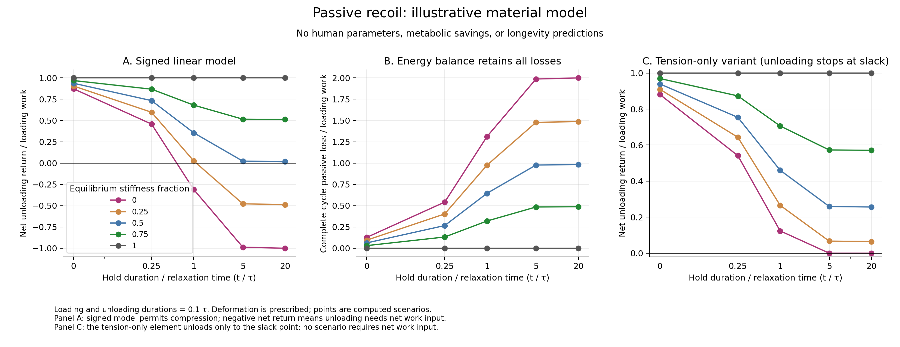

# Supplementary Material S1: verification of the illustrative viscoelastic balance

**Supplementary Material S1**

**Sayuj Krishnan** — provisional author list

Affiliation: [author to confirm]

Corresponding author and email: [author to confirm]

Running title: Floor transitions and functional aging

Target journal: Frontiers in Aging — Musculoskeletal Aging

Version: 1.0 | 2 October 2026 | Author-review draft

```{=openxml}
<w:p><w:r><w:br w:type="page"/></w:r></w:p>
```

## S1. Purpose and scope

This supplement verifies the energy balance of the illustrative standard linear solid used in the main manuscript. It supplies analytic segment solutions, an independent numerical integration, normalized scenario outputs and the complete executable code. It contains no participant data, human material calibration, fitted metabolic effect or estimated survival benefit. The law is an established viscoelastic illustration; its verification is supplementary to the proposed experimental hypothesis.

## S2. Definitions and analytic segment solution

The equilibrium spring has stiffness $k_\infty$, the Maxwell spring has stiffness $k_1$, and its dashpot coefficient is $c$. The relaxation time is $\tau=c/k_1$. Total deformation is $x$ and Maxwell-spring deformation is $z$. Force and stored elastic energy are

$$F=k_\infty x+k_1z,\qquad U_e=\tfrac12k_\infty x^2+\tfrac12 k_1z^2.$$

For a segment with constant velocity $v$, duration $t$, initial deformation $x_0$ and internal state $z_0$, set $a=v\tau$ and $b=z_0-a$. Then

$$x(t)=x_0+vt,\qquad z(t)=a+b\exp(-t/\tau).$$

The integrated external mechanical work is

$$W=\tfrac12k_\infty[x(t)^2-x_0^2]+k_1v[at+b\tau(1-\exp(-t/\tau))].$$

The passive energy loss is

$$L=\frac{k_1}{\tau}\left[a^2t+2ab\tau(1-\exp(-t/\tau))+\frac{b^2\tau}{2}(1-\exp(-2t/\tau))\right].$$

The check $W=\Delta U_e+L$ follows directly. At a fixed-deformation hold, the relaxing branch's stored energy decays exponentially while the equilibrium spring retains energy. After prescribed unloading to $x=0$, any remaining internal-state energy dissipates in a final relaxation; it is included in the complete-cycle loss.

## S3. Normalization and scenario grid

Total stiffness and deformation amplitude are set to one. Time is expressed in units of the assumed relaxation time; no empirical seconds are assigned. Energy is in units of total stiffness times deformation amplitude squared. The prescribed history starts at $x=z=0$, loads linearly to $x=1$, holds deformation, and unloads linearly to $x=0$.

| Variable | Normalized values |
|---|---|
| Equilibrium stiffness fraction $k_\infty/(k_\infty+k_1)$ | 0, 0.25, 0.5, 0.75, 1 |
| Loading duration / relaxation time | 0.1, 1, 10 |
| Holding duration / relaxation time | 0, 0.25, 1, 5, 20 |
| Unloading duration / relaxation time | 0.1, 1, 10 |

The Cartesian grid contains 225 cases, including 45 purely elastic controls. The fully elastic limit is implemented by setting $k_1=0$; the nominal time scale then has no physical role. The selected grid explores different mechanical histories and is not an estimate of a population distribution.

## S4. Independent numerical checks

An independent fourth-order Runge–Kutta integration evaluates the internal state, external work and passive loss, using 1,000 and 2,000 steps per nonzero-duration segment. It also integrates the positive and negative parts of mechanical power. Analytic solutions initialize each segment consistently. The script checks segment balances, complete-cycle balance after final relaxation, nonnegative loss, numerical agreement, refinement agreement and the purely elastic limit.

| Check | Verified result in supplied artifact |
|---|---|
| Normalized scenarios | 225 |
| Purely elastic controls | 45 |
| Maximum absolute complete-cycle balance residual | $4.6074\times10^{-15}$ |
| Maximum independent integration error | $9.496\times10^{-11}$ |
| Maximum coarse/fine refinement difference | $1.4346\times10^{-9}$ |
| Cases with negative net unloading return | 58 |

Values are rounded here; full precision is retained in recoil_model_checks.json. This verifies arithmetic under the specified law and prescribed deformation. It does not validate the law for a human movement.

## S5. Signed work, slackness and biological translation

Net unloading return is minus the integrated external work during unloading. Gross return integrates the negative part of mechanical power separately from the positive work injected during that segment. These differ when force changes sign. The linear material permits compression, and 58 histories have negative net return. A tendon can become slack and is not the same elastic element in compression; these histories must not be interpreted as biological tendon energy recovery. A human extension requires tension-only behavior, measured operating range and preload, appropriate nonlinear properties, and a mapped geometry.

The illustrative plot shows mechanical sensitivity, including a shaded region for negative net return. No value should be relabeled as a floor-rise recoil fraction, oxygen saving or aging effect. Force–deformation work does not by itself reveal whether energy originated in the preceding descent or in subsequent muscle action.

{width=6.15in}

**Figure S1. Material history determines net return.** Loading rate, hold duration and unloading rate can each affect the normalized balance. Different equilibrium fractions retain different amounts of energy through a hold. Negative net return is a feature of the signed linear model and requires caution about compression and slackness. The full grid is supplied in the CSV file; the selected panels are illustrative.

## S6. Reproducibility and provenance

Files supplied in the supplement directory are recoil_model.py, recoil_model_checks.json, recoil_sensitivity.csv, render_recoil.py, and PNG/SVG copies of Figure S1. The verified model script SHA-256 is:

`a55882621535d2a5c68ff4bd7f9c67128b7d37fd79e6b200b2adad71a0fac739`

Run `python3 recoil_model.py` inside the supplement directory to regenerate the CSV and checks. The program uses the Python standard library. Plot regeneration additionally requires Matplotlib and uses `python3 render_recoil.py`. A rerun changes the generation timestamp while preserving the model definition and outputs, subject to ordinary floating-point differences.

The supplied artifacts were copied from the verified research dossier dated 2 October 2026. They are independent of previous spine-growth simulations. Withdrawn or numerically unresolved spine mechanics are not used as evidence in this manuscript. A public repository accession and archive license require author confirmation before submission.
