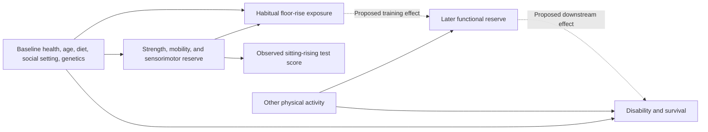

# Repeated floor rising, postural reserve, and healthy aging

Prepared 2026-10-02 IST. This is a hypothesis-development dossier based on current project files and a targeted primary-literature search, not a systematic review or a completed human study. All experimental choices below are proposals. No participant data were collected, no lifespan effect was estimated, and no clinical exercise prescription follows from this document.

## The hypothesis worth testing

**Repeated, tolerable transitions between low and upright postures may preserve the strength, mobility, and sensorimotor control needed to move independently against gravity. Floor rising may provide additional coordination practice beyond an equivalent dose of simpler exercise. Preserving these capacities could contribute to longer disability-free life; a lifespan benefit remains a separate, untested consequence.**

The central research question is whether floor rising improves *untrained functional outcomes* more than a comparator with similar exercise dose and contact. A second question is whether distributing the same exercise across the day improves outcomes more than performing it in a single bout. The user's recoil extension adds a third question: whether these transitions preserve useful elastic storage, return, and muscle coordination. These are separable hypotheses: neither requires Okinawa to be exceptional, nor the spine to grow as a helix.

## Connection to the spine project

The common principle is the dependence of upright movement on tissue properties, muscular work, and sensory control under gravitational loading. In adolescence the question is how loading, growth, and asymmetric anatomy interact with structural progression. In aging the question is how use, disuse, disease, and recovery affect functional capacity. Evidence in one age group does not validate the mechanism in the other.

The current spine review distinguishes centerline torsion, vertebral rotation, tissue twist, and growth. It also records unresolved numerical convergence in the corrected planar rod campaign. Consequently, a healthy spine cannot be assumed to be a prescribed helix, and the campaign cannot supply validated parameters for a longevity model. Source: [2026-10-01 spine review](../helical_growth_research_2026-10-01/RESEARCH_BRIEF.md) and its diagnostic results. The withdrawn material-assignment results remain inadmissible.

Translate the intuition about helicity into **measurable three-dimensional coordination of trunk, pelvis, and limbs**. Test balance, movement strategies, joint excursions, and recovery after a perturbation. Deliberately increasing spinal twist, making a spine straighter, or maximizing curvature change is not an experimental objective.

## What the evidence establishes

A Brazilian clinical cohort of 4,282 adults found that baseline sitting-rising test scores of 0–4 versus 10 predicted natural mortality: adjusted HR 3.84, 95% CI 2.25–6.97. The study used a selected private-clinic population, could not adjust for habitual physical activity, and assessed baseline ability rather than daily floor-rise exposure. It extends the same CLINIMEX research programme; it is not an independent Okinawan replication. [Araújo et al., 2025](https://academic.oup.com/eurjpc/advance-article/doi/10.1093/eurjpc/zwaf325/8163161).

Training evidence is narrower. A 2026 cluster pilot randomized 61 older adults, with 49 analyzed at follow-up. Floor-rise performance improved, but the primary fear-of-falling outcome did not. Few clusters, attrition, and baseline imbalances limit interpretation. This supports studying a trainable skill, not inferring longer survival. [Seeley et al., 2026](https://pubmed.ncbi.nlm.nih.gov/41894198/).

General exercise already has a causal functional benchmark: the LIFE trial randomized 1,635 older adults and found less major mobility disability with structured activity, HR 0.82, 95% CI 0.69–0.98. A floor-rise theory must explain an additional effect or a practical advantage over established activity. [Pahor et al., 2014](https://pubmed.ncbi.nlm.nih.gov/24866862/).

Okinawa motivates a population study, but does not establish the proposed exposure or mechanism. The OCS describes multiple lifestyle and genetic factors. A demographic analysis distinguishes favorable survival in older birth cohorts from poorer outcomes in younger cohorts. This search did not identify an Okinawan cohort with measured habitual floor-rise frequency and an adjusted prospective mortality estimate. That is a bounded search result, not proof that no such dataset exists. [OCS study methods](https://okinawacentenarian.org/the-study), [Poulain and Herm, 2024](https://onlinelibrary.wiley.com/doi/10.1111/joim.13764).

## The causal problem

Solid arrows describe important causal assumptions to account for, not estimates from a single study. Dotted arrows are the intervention hypotheses. Better health permits floor rising; that reverse direction can generate an exposure-survival association even when practice has no independent effect. A test score is not interchangeable with behavior frequency.

Long periods sitting on the floor and repeated floor-to-stand transitions are different exposures. Separate static sitting duration, number and timing of transitions, support use, actual movement strategy, and total activity. A deep squat, cross-legged rise, and kneeling sequence also impose different demands.

## Three claims with different tests

| Claim | Discriminating test | Result that weakens or rejects it |
|---|---|---|
| Floor rising adds a benefit through varied coordination | Compare with exercise of similar metabolic dose, schedule, and contact; measure untrained gait and perturbation recovery | Improvement confined to the practiced floor-rise task; adequately precise absence of the prespecified general-function benefit |
| Repeated opportunities throughout the day matter | Compare distributed and clustered versions of the same movements at equal total dose | No meaningful cadence advantage with adequate exposure separation and precision |
| Functional preservation contributes to longevity | Prospective individual-level exposure, disability, and validated survival follow-up | Association disappears after measured health/activity adjustment, or intervention fails to preserve function; an imprecise null remains inconclusive |

The first two claims can be tested without waiting decades. The third requires separate follow-up; improvements in test score, an aging clock, or a protein concentration cannot establish it.

## Mechanics and physiology

Rising increases center-of-mass potential energy by approximately `m g Δh`. Descending reverses that change. Gravity is conservative, while contraction, stabilization, and eccentric control incur physiological costs. A full up-and-down cycle is not an energy source, and extra mechanical work alone does not demonstrate beneficial adaptation.

A task-demand ratio, such as estimated required joint moment divided by measured available moment, can operationalize reserve for that task. Strength, power, mobility, and sensory control require separate measurements. Fast responses over seconds or hours must be distinguished from adaptation over weeks or months. Avoid inferring an unmeasured universal coupling parameter from any one test.

Breaking sitting with light walking or simple resistance activity improved acute metabolic outcomes in a randomized crossover trial of 24 adults with type 2 diabetes. This supports a timing experiment, while also supplying a competing explanation that does not require floor posture. [Dempsey et al., 2016](https://pubmed.ncbi.nlm.nih.gov/27208318/).

PIEZO2 provides a plausible sensory component: loss-of-function cases establish a role in human proprioception. YAP/TAZ experiments establish cellular mechanosensing. Neither demonstrates that ordinary floor rising engages a specific anti-aging cascade. [Chesler et al., 2016](https://www.nejm.org/doi/full/10.1056/NEJMoa1602812), [Dupont et al., 2011](https://www.nature.com/articles/nature10137).

Exercise trials make circulating Klotho an exploratory candidate, and FOXO3 genetic association supplies longevity-related biology. Neither establishes floor-rise specificity, an immediate reset, or mediation of lifespan. There is no basis here for treating more nuclear YAP, lower p21, or activation of a named pathway as a universally favorable outcome. [FIT-AGEING trial](https://pubmed.ncbi.nlm.nih.gov/31164040/), [Willcox et al., 2008](https://pubmed.ncbi.nlm.nih.gov/18765803/).

## Research strategy

First audit the existing assumptions and validate exposure measurement. Then run a supervised feasibility study with an active comparator. If the intervention and measurement are feasible, freeze a randomized trial with an untrained primary functional endpoint. Study distribution across the day independently of movement type. Begin a survival cohort only if reliable exposure, records, and a meaningful functional signal are available.

The working paper title is **“Repeated floor-to-stand transitions and functional reserve in aging: a mechanistic hypothesis and falsification framework.”** Its possible contribution is a measurable dose-and-coordination hypothesis. It should not claim that helical spinal growth explains Okinawan longevity or that a floor posture prolongs lifespan.

Read [the recoil and thermodynamic extension](THERMODYNAMIC_EXTENSION.md), [the connection to biological countercurvature and information thermodynamics](COUNTERCURVATURE_INFORMATION.md), [the executed model and experimental decisions](MODEL_AND_DECISIONS.md), [the assumption audit](ASSUMPTION_AUDIT.md), [the evidence ledger](EVIDENCE.md), and [the proposed study protocol](PROTOCOL_DRAFT.md) for the concrete next steps. The [recoil figure](recoil_sensitivity.png) illustrates normalized passive-material behavior, not human energy savings or lifespan.
